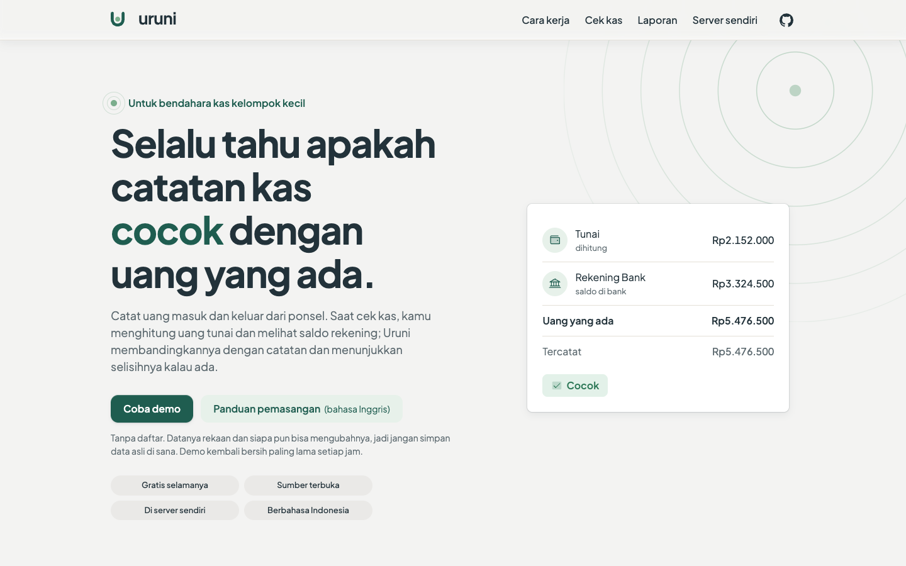
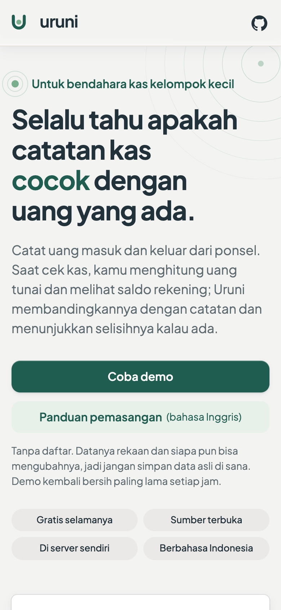

<div align="center">

<picture>
  <source media="(prefers-color-scheme: dark)" srcset="https://raw.githubusercontent.com/kerti/uruni/main/docs/brand/uruni-lockup-horizontal-reversed.svg">
  
</picture>

### The landing site for Uruni

**[uruni.kerti.dev](https://uruni.kerti.dev)**, in Bahasa Indonesia, for the treasurer nobody trained.

[Website](https://uruni.kerti.dev) · [The app](https://github.com/kerti/uruni) · [Live demo](https://demo.uruni.kerti.dev) · [Self-hosting](https://github.com/kerti/uruni/blob/main/SELF-HOSTING.md)

[](https://github.com/kerti/uruni-landing/actions/workflows/ci.yml)
[](https://github.com/kerti/uruni-landing/actions/workflows/gitleaks.yml)
[](LICENSE)

<br>

&nbsp;


</div>

---

## What this repo is

**Uruni** is a calm, free, self-hosted app for keeping a small community's shared money honest:
dues, collections and reimbursements recorded from a phone, and a cash check that shows whether
the records match the real money. The app, its docs and its domain model live in
[`kerti/uruni`](https://github.com/kerti/uruni).

This repo is only the website that introduces it: one static page in Bahasa Indonesia, built with
Astro and served by Cloudflare Pages. It holds no app code, and has no forms, cookies or analytics of its own (ADR-0001).

The app owns the domain and the brand. Words come from the app's
[`CONTEXT.md`](https://github.com/kerti/uruni/blob/main/CONTEXT.md); tokens, lockups and favicon are
copied verbatim from the app; and the page claims only what the app actually does.

**New here?**

- [`CONTEXT.md`](CONTEXT.md): voice, the naming law, what the page may claim.
- [`CONTRIBUTING.md`](CONTRIBUTING.md): how a change flows.
- [`docs/adr/`](docs/adr/): why the repo is set up the way it is.
- [`CLAUDE.md`](CLAUDE.md): rules for AI agents (and humans).

## Status

Live at <https://uruni.kerti.dev>. The app itself is in public alpha; see its
[README](https://github.com/kerti/uruni#status).

## Local development

Prerequisites: Node 24 (pinned in `.nvmrc`), and `brew install gitleaks jq` for the local hooks.

```sh
npm install        # the "prepare" script also installs the git hooks
npm run dev        # http://localhost:4321
npm run build      # static build to dist/ (what Cloudflare Pages serves)
npm run check      # the local mirror of CI: lint, format:check, astro check, build
```

Checks over the built site (run `npm run build` first; they drive the installed Chrome):

```sh
npm run visual        # responsive matrix: screenshots, overflow, lone words
npm run copy-audit    # CONTEXT.md's mechanical copy rules over the rendered text
npm run launch-check  # build, repo and live-site checks; add -- --lighthouse for scores
```

## Hosting

Cloudflare Pages through its Git integration (ADR-0002), config in ADR-0006.
`main` publishes to <https://uruni.kerti.dev>; every PR gets a preview URL.
CI holds no deploy secrets.

## License

[AGPL-3.0](LICENSE), like [the app](https://github.com/kerti/uruni).
